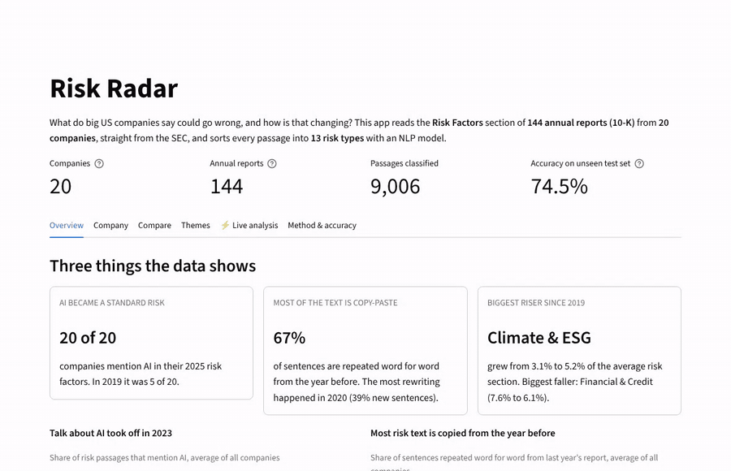
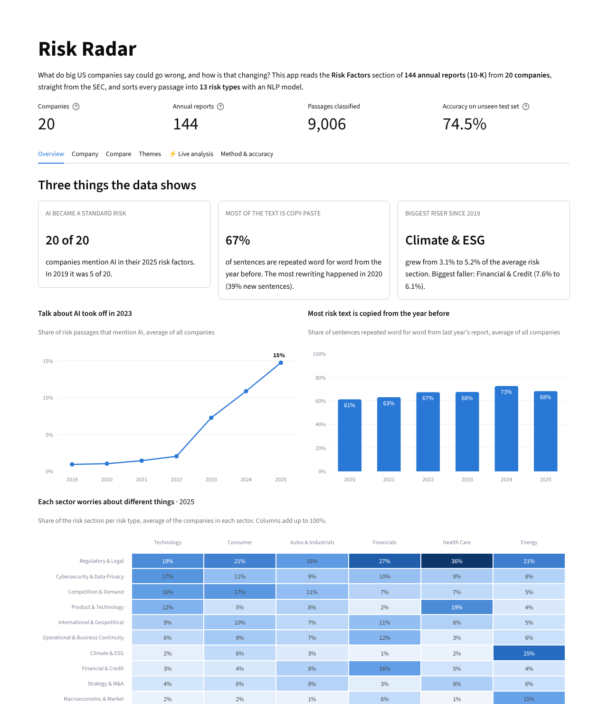
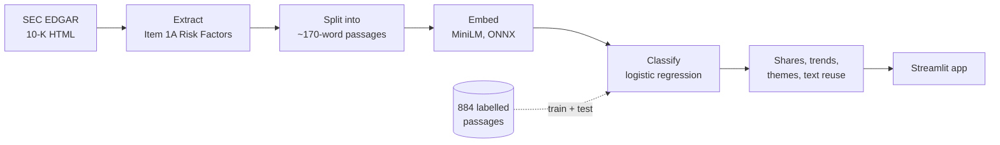

# Risk Radar

[](https://github.com/kishan244/risk-narrative-nlp/actions/workflows/ci.yml)
[](https://risk-radar-kishan-v1.streamlit.app/)


**What do big US companies say could go wrong, and how is that changing?**

Risk Radar is an end-to-end NLP pipeline. It downloads annual reports (10-K) from the SEC, finds the
*Risk Factors* section, sorts every passage into one of 13 risk types, and shows the trends in a web app.
You can also type **any US stock ticker** and watch the whole pipeline run live in a few seconds.

**[Open the live app →](https://risk-radar-kishan-v1.streamlit.app/)**



## What the data shows

| | |
|---|---|
| **AI became a standard risk** | In 2019, 5 of 20 companies mentioned AI in their risk factors. In 2025, all 20 do. The share of passages that mention AI went from 1% to 15%. |
| **Most risk text is copy-paste** | On average 67% of sentences are repeated word for word from the year before. The most rewriting happened in 2020 (39% new sentences), the first COVID year. |
| **Each sector has its own worry** | Health care: regulation and lawsuits (36% of the section). Energy: climate (25%). Autos and industrials: supply chain (15%). Banks: credit and funding (16%). |



## Numbers

| | |
|---|---|
| Companies | 20, in 6 sectors (`companies.toml`) |
| Annual reports | 144, fiscal years 2019 to 2026 |
| Passages classified | 9,006 |
| Labelled passages | 884 (684 train, 200 test), with a written [labelling guide](data/eval/LABELING_GUIDE.md) |
| **Test accuracy** | **74.5%** on 200 unseen passages (95% range 68–80%). Most-common-class baseline: 16% |
| Right label in top 2 | 84% |
| Live analysis of a new ticker | about 5 seconds on a laptop CPU |
| Tests | 40, run on every pull request |

## How it works



| Step | Module | What it does |
|---|---|---|
| Download | `riskradar/sec.py` | Ticker → company ID → every 10-K, from the free SEC EDGAR API. Polite rate limit, retries, clear errors. |
| Extract | `riskradar/extract.py` | Finds the real *Item 1A* heading. The same words also appear in the table of contents and in cross-references, so only matches at the start of a line count and the longest candidate wins. |
| Split | `riskradar/chunk.py` | Passages of about 170 words along sentence borders, sized to fit the model's 256-token window. |
| Embed | `riskradar/embed.py` | `all-MiniLM-L6-v2` through ONNX Runtime (no PyTorch). Disk cache keyed by text, so a re-run only embeds new passages. |
| Classify | `riskradar/classify.py` | Multinomial logistic regression. Only the weights are stored (25 KB), so predicting needs NumPy alone. |
| Train + test | `riskradar/train.py` | Trains on `data/eval/labels.csv` and scores once on the held-out test set. |
| Build | `riskradar/build.py` | Runs everything for all companies and writes the small files the app reads (`data/app/`). |
| Live | `riskradar/analyze.py` | The same pipeline for one ticker, used by the app's live tab and the CLI. |

## How the accuracy was measured

A number is only worth something if the test is fair, so the test is strict:

1. **A random test set.** 200 passages, 10 per company, drawn at random. They are never used to train or to choose a setting.
2. **No leaks through copy-paste.** 10-K filings repeat paragraphs every year. Any training passage that is a near-copy of a test passage (cosine similarity ≥ 0.9) is removed from training. This removed 17 passages.
3. **Settings chosen without the test set.** The regularisation strength is picked by cross-validation on the training set only.
4. **Scored once per round.** Round 1 (339 training passages) scored 67%. Round 2 added 328 training passages, chosen where the model was least sure, and scored 74.5%. Nothing else was changed between the two rounds.

Per-category scores, the confusion matrix and accuracy per sector are in the app's *Method & accuracy* tab and in `models/metrics.json`.

## Design decisions

- **A small model on purpose.** `bge-small` and `bge-base` gave no better accuracy in cross-validation but were 17× and 60× slower. The small model makes the live tab possible on free hosting.
- **Shares, not counts.** A longer report would otherwise look riskier just because it is longer.
- **Keyword themes stay simple.** "How many companies mention AI?" is answered with a transparent keyword rule, not a model.
- **Text reuse is measured on sentences.** Sentences are compared after dropping spaces and punctuation, so a company that changes how it writes its own name does not look like it rewrote everything.
- **A ticker is not a company ID.** ExxonMobil's ticker now points to a new legal entity without old filings, so `companies.toml` can pin the SEC company ID.
- **Fiscal years are lined up.** Year-ends in January or February (Walmart, NVIDIA) count as the year before.

## Limits

- One label per passage. About one passage in four covers two risks, which is why top-2 accuracy (84%) is much higher than accuracy (74.5%).
- Energy companies are the weak spot (45% on 20 test passages). Their passages pack several topics together.
- 20 large US companies are a sample, not the market.
- The app measures what companies write about, not how likely a risk is. Not investment advice.

## Run it yourself

```bash
pip install -r requirements-dev.txt

python -m riskradar analyze NFLX   # full pipeline for one ticker, about 5 seconds
streamlit run app.py               # the web app

python -m riskradar build          # rebuild all data (downloads 144 filings on the first run)
python -m riskradar train          # retrain and re-score the classifier
make lint test                     # ruff + 40 tests
```

Add a company: put its ticker in `companies.toml` and run `python -m riskradar build`.

A scheduled GitHub Action (`.github/workflows/refresh.yml`) looks for new filings once a month. If it finds any, it rebuilds the data and pushes a branch for review.

## Project layout

```
app.py                 Streamlit app (6 tabs)
companies.toml         the 20 companies
riskradar/             the pipeline as a Python package (+ CLI)
data/app/              small precomputed files the app reads
data/eval/             labelled passages and the labelling guide
models/                classifier weights and test metrics
tests/                 40 tests: extraction, SEC client, classifier, data checks, app smoke test
legacy/                the first version of this project (kept for history)
```

## How the project improved

- **Started** as a semester project that read PDFs and used BERTopic. A check showed the topics followed the company, not the risk type, and that part of the input text was not risk text at all. That code is kept in `legacy/`.
- **Rebuilt** on SEC EDGAR with proper section extraction and a classifier, first for 3 companies.
- **Scaled** to 20 companies (21 → 144 reports) with a 7× larger labelled set and a strict test protocol. More labelled passages raised test accuracy from 67% to 74.5%, and a 17× faster model made live analysis of any ticker possible. Tests, CI and a monthly data refresh were added.

## Tech

Python · pandas · NumPy · scikit-learn · ONNX Runtime (fastembed) · lxml · Plotly · Streamlit · pytest · ruff · GitHub Actions
