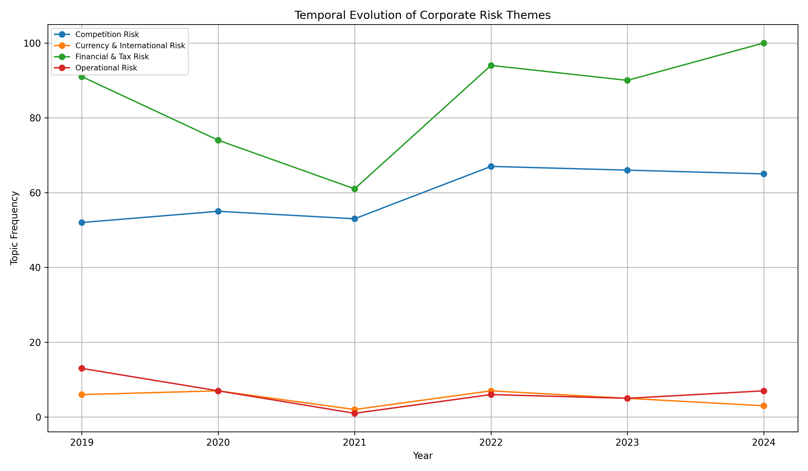
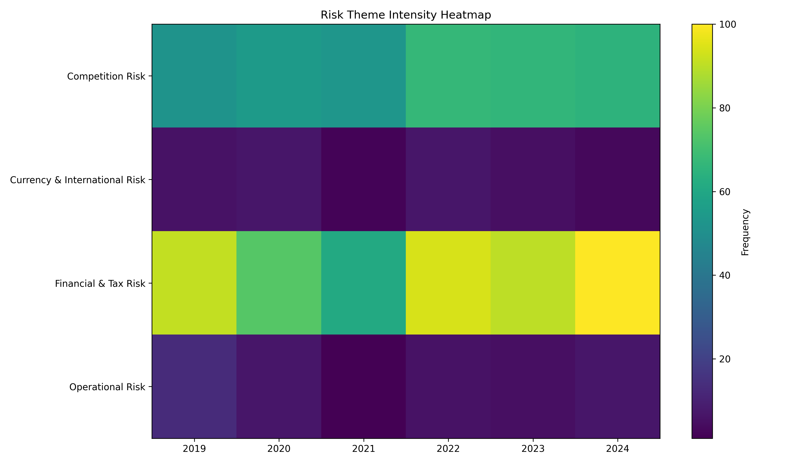

# Semantic Evolution of Corporate Risk Narratives in Annual Reports

A transformer-based NLP pipeline that extracts the Risk Factors section from corporate 10-K annual reports and analyzes how risk themes evolve over time, using sentence embeddings and BERTopic topic modeling.

## Overview

Every public company's annual report (10-K) contains a "Risk Factors" section describing what could hurt the business. These sections change year to year as new risks (cybersecurity, supply chain, macro conditions) rise and fall in prominence — but reading six years of filings across multiple companies by hand doesn't scale.

This project is an **NLP semester project** built to explore whether transformer-based topic modeling can automatically surface and track that evolution. Given a set of 10-K filings for a company across multiple years, the pipeline:

- extracts just the Risk Factors section from each PDF
- splits it into semantic chunks and embeds them with a sentence-transformer model
- clusters the embeddings into topics with BERTopic
- maps discovered topics to human-readable risk categories (e.g. Cybersecurity & Privacy, Supply Chain, Competition)
- tracks how each risk theme's frequency changes across years and companies
- generates charts and written reports summarizing the findings

The current dataset used for development covers **Apple, JPMorgan, and Tesla, 2019–2024**, chosen to compare risk narratives across very different industries (consumer tech, banking, EV/auto manufacturing).

## Key results

| | |
|---|---|
| Reports analysed | 17 annual reports (10-K): Apple, JPMorgan, Tesla, 2019–2024 (JPMorgan 2021 not available) |
| Text chunks | 1,499 (≈180 words each, max 100 per report) |
| Risk categories | 8, auto-labelled from BERTopic topics |
| Strongest rise | Competition risk: 52 → 65 mentions |
| Strongest fall | Operational risk: 13 → 7 mentions |
| Highest intensity | Financial & tax risk in 2024 (100) |

## Pipeline

The end-to-end flow, as implemented in `main.py`:

1. **PDF text extraction** (`pipeline.py`) — Each 10-K PDF is read page-by-page with `pdfplumber` and concatenated into a single text blob.

2. **Risk Factors section extraction** (`pipeline.py`) — The text is searched for "Item 1A – Risk Factors" heading patterns (several variants are matched to handle formatting differences across filers) and sliced out up to the start of "Item 1B" / "Item 1C" / "Item 2". A fallback skips false positives from the table of contents by requiring a minimum section length.

3. **Chunking** (`pipeline.py`) — The extracted Risk Factors text is split into ~180-word chunks (`CHUNK_SIZE`), discarding chunks under 80 words (`MIN_WORDS_PER_CHUNK`). To keep longer filings (e.g. JPMorgan's) from dominating the topic model, each report contributes at most 100 chunks (`MAX_CHUNKS_PER_REPORT`).

4. **Embedding + topic modeling** (`pipeline.py`) — Each chunk is embedded using the `all-MiniLM-L6-v2` sentence-transformer model, then clustered with **BERTopic**, using a custom-configured **UMAP** (dimensionality reduction) and **HDBSCAN** (density-based clustering) model underneath it.

5. **Automatic topic labeling** (`pipeline.py`) — Each discovered topic's keyword representation is scored against a hand-defined keyword dictionary for 8 risk categories (Cybersecurity & Privacy, Supply Chain, Operational, Competition, Financial & Tax, Currency & International, Product Quality, Trade & Vendor) and assigned the best-matching label, or "Unclassified Risk" if nothing matches well.

6. **Temporal aggregation & reporting** (`report_generator.py`) — Labeled topic frequencies are grouped by company/year/theme to identify which risk themes are increasing, decreasing, or stable over the 2019–2024 window, written out as a plain-text findings report.

7. **Semantic shift analysis** (`semantic_shift.py`) — For each company and risk theme, the pipeline pulls a representative text chunk from 2019 and a representative chunk from 2024 (selected by keyword-match score) and pairs them side by side as qualitative evidence of how the language around that risk theme actually changed.

8. **Visualization** (`final_visuals.py`) — Generates a multi-line topic evolution chart, a risk-theme intensity heatmap, a per-company risk theme comparison bar chart, and a risk narrative volume trend chart, all via `matplotlib`.

9. **Evaluation** (`evaluation.py`) — Reports basic model diagnostics: outlier rate (chunks that didn't cluster into any topic), number of discovered topics, automatic label coverage, and number of years/themes covered — framed honestly as unsupervised-model diagnostics, not accuracy metrics.

## Tech Stack

- **pdfplumber** — PDF text extraction
- **sentence-transformers** (`all-MiniLM-L6-v2`) — semantic embeddings
- **BERTopic** — topic modeling
- **UMAP** (`umap-learn`) — dimensionality reduction (used as BERTopic's clustering backbone)
- **HDBSCAN** — density-based clustering (used as BERTopic's clustering backbone)
- **pandas** — data wrangling and aggregation
- **matplotlib** — charts and visualizations

## Data

**The raw 10-K PDFs are not included in this repository** (they're excluded via `.gitignore` — SEC filings are large binary files and third-party content, not something to vendor into a public repo).

To run the pipeline yourself, download the Risk Factors–containing 10-K filings for the companies/years you want to analyze from **SEC EDGAR** (https://www.sec.gov/edgar) and place them in the following structure:

```text
data/raw pdf/
├── apple/
│   ├── apple_2019.pdf
│   ├── apple_2020.pdf
│   ├── apple_2021.pdf
│   ├── apple_2022.pdf
│   ├── apple_2023.pdf
│   └── apple_2024.pdf
├── jpmorgan/
│   ├── jpmorgan_2019.pdf
│   ├── ...
│   └── jpmorgan_2024.pdf
└── tesla/
    ├── tesla_2019.pdf
    ├── ...
    └── tesla_2024.pdf
```

Notes on the expected structure:
- Company folder names just need to contain a recognizable alias (e.g. `apple`, `aapl`; `jpmorgan`, `jpm`, `chase`; `tesla`, `tsla`) — matching is case-insensitive and ignores punctuation/spacing.
- Within each company folder, files are expected as `<company>_<year>.pdf` (e.g. `apple_2021.pdf`); if that exact name isn't found, the pipeline falls back to any PDF in the folder whose name contains the year.
- The companies and year range analyzed are configured in `config.py` (`COMPANIES`, `YEARS`) — edit these to point the pipeline at different companies or years.

## Installation & How to Run

```bash
# 1. Create and activate a virtual environment
python3 -m venv venv
source venv/bin/activate      # on Windows: venv\Scripts\activate

# 2. Install dependencies
pip install -r requirements.txt

# 3. Add your PDFs under data/raw pdf/<company>/ as described above

# 4. Run the full pipeline
python main.py
```

Running `main.py` executes the full pipeline in order: PDF processing → topic modeling → report generation → visualizations → semantic shift report → evaluation report. Progress and any missing-file warnings are printed to the console as it runs.

## Outputs

All generated artifacts are written to `outputs/`:

**Reports (text)**
- `final_report.txt` — key findings and per-theme trend interpretation (increasing/decreasing/stable) across the reporting period
- `semantic_evolution_report.txt` — 2019 vs. 2024 representative text side-by-side for each company/risk theme, with a qualitative interpretation of the shift
- `model_evaluation_report.txt` — topic modeling diagnostics (outlier rate, topic count, label coverage)

**Data (CSV)**
- `final_topic_info.csv` — discovered topics with keyword representations and auto-assigned labels
- `final_chunk_topics.csv` — every text chunk with its assigned topic
- `final_temporal_topics.csv` — topic frequency by company/year
- `final_labeled_topic_trends.csv` — topic frequency by company/year, aggregated under human-readable labels

**Charts (PNG)**
- `final_topic_evolution_chart.png` — risk theme frequency over time, all companies combined
- `final_topic_heatmap.png` — risk theme intensity heatmap across years
- `company_risk_theme_comparison.png` — risk theme totals compared across companies
- `company_risk_volume_trend.png` — total risk-narrative volume per company over time

**Extracted text**
- `<company>_<year>_risk.txt` — the raw extracted Risk Factors section per filing, before chunking

### Example output





## Limitations

- Topic modeling is unsupervised — cluster quality depends on embedding and clustering hyperparameters, and results should be read as exploratory analysis, not ground truth.
- Automatic topic labeling is keyword-based and may mislabel or leave topics as "Unclassified Risk" if they don't match the predefined keyword sets.
- Results are analytical/academic in nature and are not intended as legal, financial, or investment advice.
